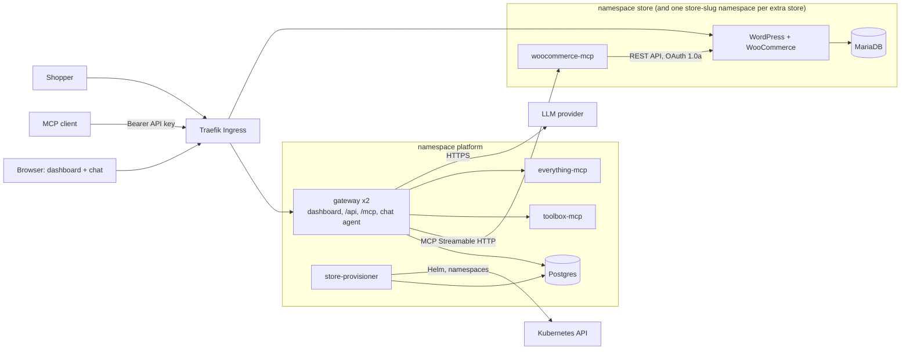

# WooCommerce hosting with a Team MCP Gateway

A WooCommerce store on Kubernetes, an MCP server written for it, and a team MCP gateway with a dashboard and a
chat agent. An admin registers MCP servers once; every team member then uses all of them through **one MCP
endpoint** (Claude Code, Cursor, MCP Inspector) and through the **chat agent**, with their own API key,
per-role tool permissions and an audit log of every call. Optionally, users create further stores from the
dashboard, each in its own namespace and connected to the gateway automatically.

**Status:** the system runs on a local k3d cluster and was last deployed and verified there on 2026-10-26.
The production-like VPS (k3s) setup is documented and its values are validated, but **no VPS deployment has
been performed**. Details: [docs/submission-readiness.md](docs/submission-readiness.md).

| Document | Contents |
|---|---|
| [docs/design.md](docs/design.md) | System design and trade-offs, diagrams, tool routing, failure handling, Kubernetes resources, multi-store provisioning |
| [docs/threat-model.md](docs/threat-model.md) | Threat model: shared credentials, no token passthrough, untrusted upstreams, member boundaries, control inventory |
| [docs/deployment.md](docs/deployment.md) | Local and VPS procedures, secrets, backups, upgrade/rollback, troubleshooting |
| [docs/submission-readiness.md](docs/submission-readiness.md) | Verification report: every requirement with status, evidence and limitations |

## Capabilities

- **Store:** WordPress 7.1.3 + WooCommerce 11.2.1 + MariaDB on Kubernetes, persistent volumes, Cash on delivery
  and free shipping preconfigured.
- **WooCommerce MCP server** (`apps/woocommerce-mcp`, our own): `list_products`, `create_product`,
  `list_orders`, `get_order`, `update_order_status` over MCP Streamable HTTP; talks to WooCommerce's REST API
  with OAuth 1.0a-signed requests; reachable only by the gateway.
- **Gateway:** one MCP endpoint (`/mcp`) aggregating every enabled upstream as `<server>__<tool>`; admins add,
  edit, disable and remove upstreams with an optional bearer or custom-header credential (encrypted at rest,
  never sent to clients); per-server timeouts and failure isolation; SSRF protection.
- **Team:** admin and member roles enforced in the backend; per-user API keys (hashed, revocable); admin-only
  tools hidden and rejected; audit log of every call (user, server, tool, time, duration, outcome).
- **Chat agent:** an LLM tool loop in the dashboard that calls tools through the same broker as the MCP
  endpoint, as the logged-in user, and shows each tool call.
- **Upstreams:** WooCommerce MCP, `toolbox-mcp` (ours: currency conversion, time, echo) and
  `everything-mcp` (third-party reference server, treated as untrusted).
- **Bonus:** multi-store provisioning with per-store namespace, database, Secrets, volumes, Ingress,
  NetworkPolicies, quotas and automatic MCP registration ([list below](#bonus-and-stand-out-items)).

Key design decisions (full list in [design.md](docs/design.md#architecture-decisions)): the broker is the
single enforcement point for both the MCP endpoint and the chat agent; the MCP endpoint is stateless so
gateway replicas need no sticky sessions; client tokens terminate at the gateway and upstreams get their own
credential; the gateway has no Kubernetes credentials (a separate store-provisioner does); secrets live only
in Kubernetes Secrets created outside Helm.

## Architecture



Only Traefik is exposed; every MCP server and database is ClusterIP-only and NetworkPolicies allow only the
flows shown. The detailed diagram and a tool-call sequence diagram are in [design.md](docs/design.md#architecture).

## Repository structure

| Path | Responsibility |
|---|---|
| `apps/gateway/src` | Gateway: MCP endpoint (`mcp.ts`), broker (`broker.ts`), upstream pool (`upstreams.ts`), SSRF guard (`url-guard.ts`), REST API (`api.ts`), auth (`auth.ts`, `crypto.ts`), chat agent (`agent.ts`), migrations (`migrations/`), multi-store API and provisioner (`stores.ts`, `provisioner.ts`, `kube.ts`, `provisioner-main.ts`) |
| `apps/dashboard` | React dashboard (built into the gateway image, served same-origin) |
| `apps/woocommerce-mcp` | WooCommerce MCP server (`server.ts` tools, `wc-client.ts` REST client, `oauth1.ts` signing) |
| `apps/toolbox-mcp` | Second upstream MCP server |
| `apps/*/test` | Unit and integration tests (`node --test`) |
| `deploy/charts/store` | Store chart: WordPress, MariaDB, woocommerce-mcp, setup Job, NetworkPolicies, quota; `values-local.yaml`, `values-prod.yaml` |
| `deploy/charts/platform` | Platform chart: gateway, Postgres, toolbox-mcp, everything-mcp, store-provisioner, RBAC, admission policy, NetworkPolicies; `values-local.yaml`, `values-prod.yaml` |
| `deploy/k3d.yaml` | Local cluster definition |
| `Dockerfile` | One target per image (gateway, app, everything-mcp, store-provisioner) |
| `Makefile` | `up`, `cluster`, `images`, `import`, `secrets`, `deploy-local`, `deploy-prod`, `e2e`, `status`, `charts-check`, `down` |
| `scripts/create-secrets.sh` | Creates every Kubernetes Secret (charts only reference them) |
| `scripts/e2e.ts` | Definition-of-done checks with two users, against any deployment |
| `scripts/chart-checks.sh`, `scripts/image-check.sh` | Security invariants of the rendered charts; image smoke checks |
| `.github/workflows/ci.yml` | CI: lint, typecheck, tests (with Postgres), build, five image builds, chart checks |

## Local setup

**Prerequisites** (verified versions in [deployment.md](docs/deployment.md#prerequisites)): Docker with at
least 4 GB of memory, k3d ≥ 5.6, kubectl, Helm 3 or 4, Node.js 24 (`.node-version`; Node 23.0–23.7 cannot run
the gateway tests), pnpm 10 (via corepack), openssl. Free ports 80 and 443.

```bash
git clone <repository URL> && cd mcp-gateway-woocommerce
pnpm install
cp .env.example .env     # optional: fill in Azure OpenAI settings for the chat agent (see below)
make up                  # k3d cluster, images, secrets, both Helm releases (5–8 min the first time)
```

`make up` = `make cluster images import secrets deploy-local status`. At the end it prints the URLs and the
generated **dashboard admin email and password** (`make status` prints them again; keep them out of
screenshots). Expected: all pods Running, the `store-setup` Job Completed, three PVCs Bound.

| URL | What |
|---|---|
| `http://app.localtest.me` | Dashboard |
| `http://app.localtest.me/mcp` | MCP endpoint (Streamable HTTP) |
| `http://store.localtest.me` | Storefront; WooCommerce admin at `/wp-admin` |
| `http://<slug>.store.localtest.me` | Stores created from the dashboard |

**Local domains.** `*.localtest.me` is public DNS that resolves to `127.0.0.1`, so no `/etc/hosts` edits are
needed. `deploy/k3d.yaml` maps the laptop's ports 80/443 to Traefik inside the cluster, and Traefik routes by
host name to the Ingresses. Offline, add `127.0.0.1 app.localtest.me store.localtest.me` to `/etc/hosts`.

**WordPress admin login** (for wp-admin):
`kubectl -n store get secret store-wp-admin -o jsonpath='{.data.WP_ADMIN_PASSWORD}' | base64 -d` (user `admin`).

### Secrets and the LLM key

`scripts/create-secrets.sh` (run by `make up` / `make secrets`) creates every Secret with random values and
never overwrites one that exists; the charts only reference Secrets by name. Nothing secret is committed:
`.env` is gitignored. The table of Secrets is in [deployment.md](docs/deployment.md#3-secrets).

The chat agent needs an LLM. Put Azure OpenAI settings in `.env` (the variables are listed in
`.env.example`), then `make secrets deploy-local`; this refreshes the `gateway-llm` Secret and restarts the
gateway. Any OpenAI-compatible API also works (`LLM_PROVIDER=openai`), by creating the Secret by hand as shown
in [deployment.md](docs/deployment.md#llm-provider-chat-agent). Without a key, chat is disabled and
everything else works.

## Using the dashboard

Sign in at `http://app.localtest.me` with the admin credentials from `make status`.

| Page | What you can do |
|---|---|
| **Servers** | See every registered server with status **Connected / Unreachable** (with the reason) / **Disabled** and its tools. Admins: **Add server** (slug, name, URL, timeout, credential **None / Bearer token / Custom header**, admin-only tools), **Edit**, **Disable/Enable**, **Remove**. The WooCommerce server (`woocommerce`), `toolbox` and `everything` are registered on first start. Credentials are write-only |
| **Team** (admin) | **Invite** a member or admin by name and email; copy the one-time invite link (valid 72 h). The invitee opens it and sets a password (10+ characters). Change roles, disable users (ends their sessions and rejects their keys) |
| **Keys** | **Generate key**: the key (`mgw_…`) is shown once, with ready-made Claude Code and Cursor configuration. **Revoke** takes effect on the next request. Admins can generate a key **For** a member (it acts and is audited as that member) and tick **Show all team keys** to see and revoke any key |
| **Chat** | Ask questions; the agent calls tools as you and shows each tool call and its result |
| **Audit** | Every tool call and rejected attempt: when, user, via (`mcp` / `chat`), server, tool, duration, outcome; filter by outcome or server. Members see only their own calls |
| **Stores** | Create a store (name + slug); see status Provisioning / Ready / Failed with the reason, URL, tools and created time; **Retry** a failed store; **Delete** your store (admins: any) |

## WooCommerce workflow: product → order → gateway

1. **Create a product through the permitted tool.** `woocommerce__create_product` is admin-only (members
   neither see nor can call it). As an admin, in **Chat**: *"Create a product called Demo Mug priced 12.50"*.
   The agent calls `woocommerce__create_product` and returns the product, including its `permalink`. The same
   tool is available to an admin's MCP client.
2. **Place an order on the storefront.** Open the permalink (or `http://store.localtest.me/shop/`), **Add to
   cart**, **Checkout**, fill in any address, choose **Cash on delivery**, **Place order**. The order appears
   in WooCommerce admin → WooCommerce → Orders.
3. **Verify the order through the gateway**, as any user: in **Chat** ask *"What orders came in today?"*
   (the agent calls `woocommerce__list_orders` with `created_on`), or from an MCP client call
   `woocommerce__list_orders` with `{"created_on": "<YYYY-MM-DD>"}` and `woocommerce__get_order` with
   `{"order_id": <id>}`. The calls appear under your user in **Audit**.

The store runs on UTC and the agent uses the UTC date, so between 00:00 and 05:30 IST "today" is still the
previous UTC day.

## Connecting an external MCP client

Only the gateway URL and your own key are needed (Dashboard → Keys → Generate key); upstream servers and
their credentials are never exposed. Transport: **Streamable HTTP**. Authentication: header
`Authorization: Bearer mgw_<id>_<secret>`.

```bash
# Claude Code
claude mcp add --transport http urumi-gateway http://app.localtest.me/mcp \
  --header "Authorization: Bearer mgw_<id>_<secret>"
```

```jsonc
// Cursor (~/.cursor/mcp.json) or another client that supports Streamable HTTP with headers
{ "mcpServers": { "urumi-gateway": { "url": "http://app.localtest.me/mcp",
    "headers": { "Authorization": "Bearer mgw_<id>_<secret>" } } } }
```

MCP Inspector: `npx @modelcontextprotocol/inspector`, transport *Streamable HTTP*, URL as above, header
`Authorization: Bearer mgw_<id>_<secret>`.

Tools appear as `<server>__<tool>`, e.g. `woocommerce__list_orders`, `toolbox__convert_currency`. A prompt
that uses two servers: *"What orders came in today, and what is their total in EUR?"*. Verified clients:
Claude Code and MCP Inspector; Cursor was not tested.

## Production-like deployment (VPS with k3s)

Same charts and Makefile targets, different values (`values-prod.yaml`). Full procedure in
[deployment.md](docs/deployment.md#4-production-like-setup-vps-with-k3s); **it has not been run on a VPS**.

1. Install k3s (Traefik, local-path storage, NetworkPolicies included) and cert-manager with a ClusterIssuer
   named `letsencrypt`.
2. DNS A records for `app.<domain>`, `store.<domain>` and `*.store.<domain>`.
3. Build the images for the VPS architecture and push them with version tags to a registry the node can pull
   from (the charts have no `imagePullSecrets`).
4. Set hosts, image references and storage in both `values-prod.yaml` files (the store chart's is bundled into
   the store-provisioner image, so edit it before building).
5. `ADMIN_EMAIL=<you@example.com> make secrets deploy-prod`.

**What changes from local:** DNS names; TLS via cert-manager on the same Traefik Ingresses (plus a
NetworkPolicy for the HTTP-01 solver); secure cookies; registry images with version tags instead of imported
`:dev` images; storage class and larger volumes (store 10 Gi each, Postgres 5 Gi); 2 woocommerce-mcp replicas;
the API server address for the store-provisioner's egress policy (read from the cluster by `make
deploy-prod`); Secrets from the same script or a secret manager. Backups (manual `pg_dump` / `mariadb-dump`)
and upgrade/rollback with Helm are described in [deployment.md](docs/deployment.md#6-backups); everything
else (templates, probes, limits, NetworkPolicies, RBAC) is identical.

## Testing

| What | Command | Needs |
|---|---|---|
| Lint, types | `pnpm lint && pnpm typecheck` | — |
| Unit + integration tests (real MCP servers, real Postgres) | `TEST_DATABASE_URL=postgres://… pnpm test` | A disposable Postgres database; DB tests are skipped without it |
| Dashboard build | `pnpm build` | — |
| Charts: lint, render both environments, schema-validate, security invariants | `make charts-check` | Helm, kubeconform |
| Images build and contain what they need | `docker build --target …` then `scripts/image-check.sh <image> <kind>` | Docker |
| Definition of done, two users, incl. revoke / disable / dead upstream | `make e2e` | Running cluster. **Mutates state:** creates a member user, keys and a product, disables and re-enables `toolbox`, scales `everything-mcp` to 0 and back |

CI (`.github/workflows/ci.yml`) runs lint, typecheck, tests, build, all five image builds with smoke checks and
`make charts-check` on every push and pull request. Latest results and the live verification are in
[docs/submission-readiness.md](docs/submission-readiness.md).

## Troubleshooting

| Symptom | Fix |
|---|---|
| `app.localtest.me` does not resolve | Offline or DNS filtering: add the `/etc/hosts` line above |
| Pods `ErrImageNeverPull` | `make images import` |
| Code change not visible after `make images import deploy-local` | Same `:dev` tag: `kubectl -n <ns> rollout restart deploy/<name>` |
| Gateway crash-looping with `missing env` / `ENCRYPTION_KEY` | `make secrets`, then restart the gateway |
| Server shows **Unreachable** | The reason is shown next to it (connection refused, timeout, HTTP 401); check the upstream pod and credential |
| `url_rejected` when adding a server | External servers must use `https://`; private and metadata addresses are refused |
| MCP client gets 401 | Header must be `Authorization: Bearer mgw_…`; the message says whether the key is missing, malformed, unknown, revoked or its user disabled |
| A member cannot see `create_product` | By design: admin-only tool |
| Chat is disabled | No LLM key: see "Secrets and the LLM key" |
| Store stuck or **Failed** | The reason is in the Stores table; `kubectl -n platform logs deploy/store-provisioner`; **Retry** |
| Pods restart after the laptop wakes | Probes time out during host sleep; pods recover. Disable sleep while demoing |

More, including storage, database, provisioner RBAC and test-environment issues:
[deployment.md](docs/deployment.md#8-troubleshooting).

## Bonus and stand-out items

| Item | Status | Where |
|---|---|---|
| **Multi-store provisioning** (bonus): create/delete from the dashboard, namespace + database + Secrets + volumes + Ingress per store, automatic MCP registration (`store-<slug>__*`), NetworkPolicy isolation, ResourceQuota/LimitRange, 2 stores per user, 15 min timeout, safe retry and restart recovery, clean teardown | Implemented; verified on local k3d (create/register/call/delete on 2026-10-26; concurrency, restart recovery and cross-store chat on 2026-10-22) | `apps/gateway/src/{stores,provisioner,kube,provisioner-main}.ts`, `deploy/charts/platform/templates/provisioner.yaml`, `deploy/charts/store/templates/guardrails.yaml`, Dashboard → Stores; [design](docs/design.md#multi-store-provisioning) |
| Tool permissions: admin-only tools hidden and rejected; store owners may use their own store's write tools | Implemented, tested | `apps/gateway/src/broker.ts`, Servers → Edit |
| Security hardening: SSRF guard (registration and connect time, DNS rebinding, redirects refused), default-deny NetworkPolicies, non-root containers, credentials encrypted at rest, least-privilege provisioner RBAC with an admission policy and Pod Security | Implemented, tested; RBAC/admission verified live 2026-10-26 | `url-guard.ts`, `crypto.ts`, `deploy/charts/*/templates/networkpolicy.yaml`, `provisioner.yaml`; [threat model](docs/threat-model.md#5-control-inventory) |
| Scaling: 2 stateless gateway replicas, no sticky sessions | Implemented, tested | `mcp.ts`, `deploy/charts/platform/templates/gateway.yaml` |
| Rate limits per user or key | **Not implemented** (only a per-upstream in-flight limit) | — |
| Observability: per-call audit (outcome, duration, error), upstream status with the reason | Implemented | Dashboard → Audit / Servers |
| Metrics endpoint, tracing | **Not implemented** | — |
| Production-like VPS deployment with TLS | **Documented and validated, not deployed** | [deployment.md](docs/deployment.md#4-production-like-setup-vps-with-k3s), `values-prod.yaml` |
| Upgrades and rollback with Helm | Documented; upgrade and rollback exercised on k3d | [deployment.md](docs/deployment.md#7-upgrades-and-rollback) |
| OAuth on the gateway, hosted MCP servers by image, tool search for large catalogs | **Not implemented** | — |
