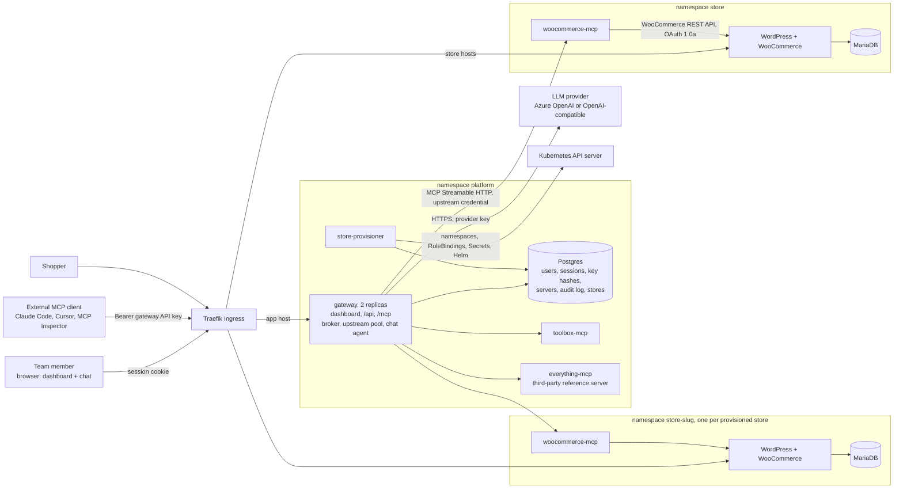
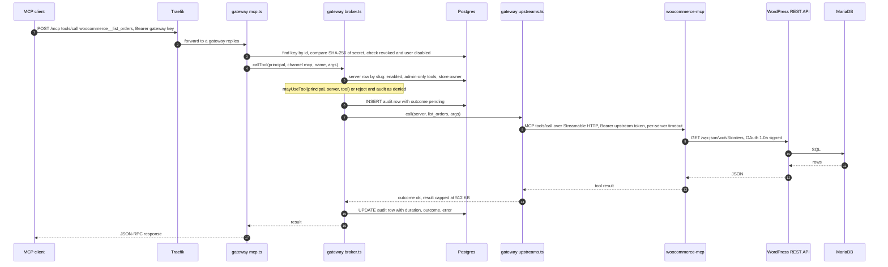

# System design and trade-offs

How the system is built and why. Procedures are in [deployment.md](deployment.md), security analysis in
[threat-model.md](threat-model.md), and verification evidence in
[submission-readiness.md](submission-readiness.md).

- [Architecture](#architecture)
- [Components](#components)
- [A tool call, end to end](#a-tool-call-end-to-end)
- [Upstream servers: registration, health and connections](#upstream-servers-registration-health-and-connections)
- [Tool aggregation, naming and routing](#tool-aggregation-naming-and-routing)
- [Authentication and authorization](#authentication-and-authorization)
- [Failure handling](#failure-handling)
- [Chat agent](#chat-agent)
- [Credentials, keys and audit](#credentials-keys-and-audit)
- [Persistence and gateway replicas](#persistence-and-gateway-replicas)
- [WooCommerce MCP server](#woocommerce-mcp-server)
- [Kubernetes resources](#kubernetes-resources)
- [Multi-store provisioning](#multi-store-provisioning)
- [Architecture decisions](#architecture-decisions)
- [What changes for production](#what-changes-for-production)
- [Trade-offs and known limitations](#trade-offs-and-known-limitations)

## Architecture



Only Traefik is exposed. Every MCP server and database is a ClusterIP Service, and NetworkPolicies restrict
each flow to the arrows above (see [Kubernetes resources](#kubernetes-resources)). Nothing but the gateway
calls an MCP server; the chat agent is a module of the gateway and uses the same broker as `/mcp`.

## Components

| Component | Runs as | Responsibility |
|---|---|---|
| WordPress + WooCommerce | Deployment (1, `Recreate`) + PVC, ns `store` | The store. Public via Ingress `store.<domain>` |
| MariaDB | StatefulSet + PVC, ns `store` | Store database. Reachable only by WordPress and the setup Job |
| Store setup Job | Helm post-install/post-upgrade hook | Idempotently installs WordPress + WooCommerce 11.2.1, Cash on delivery, free shipping, and the REST API key from a Secret |
| woocommerce-mcp | Deployment, ClusterIP, ns `store` | Our MCP server: `list_products`, `create_product`, `list_orders`, `get_order`, `update_order_status` |
| gateway | Deployment (2 replicas), ns `platform` | MCP endpoint, upstream pool, broker, REST API, chat agent, serves the dashboard |
| Postgres | StatefulSet + PVC, ns `platform` | Users, sessions, invites, API key hashes, server registry, audit log, stores |
| toolbox-mcp | Deployment, ClusterIP, ns `platform` | Our second upstream: `convert_currency`, `current_time`, `echo` (header credential `X-Api-Key`) |
| everything-mcp | Deployment, ClusterIP, ns `platform` | Third-party reference server (`@modelcontextprotocol/server-everything@2026.8.31`), treated as untrusted |
| store-provisioner | Deployment (1, `Recreate`), ns `platform`, no Service | Multi-store bonus: the only component with Kubernetes credentials |

Everything that must scale, fail or be secured independently is its own workload; everything else is a
module inside the gateway. The dashboard (React, `apps/dashboard`) is a static bundle served by the gateway
(same origin: no CORS, `SameSite=Strict` cookies work), and the chat agent is a gateway module (ADR 4).

### Gateway modules (`apps/gateway/src`)

| File | Responsibility |
|---|---|
| `mcp.ts` | The single MCP endpoint. Authenticates the gateway API key, then serves `tools/list` / `tools/call` from the broker |
| `broker.ts` | **Single enforcement point** for the MCP endpoint and the chat agent: resolve name → server, check enabled and permission, audit, call |
| `upstreams.ts` | One MCP client per upstream per replica, tool cache, health checks, timeouts, in-flight limit |
| `url-guard.ts` | SSRF policy at registration and at socket-connect time |
| `servers.ts` | Admin CRUD for upstreams; credentials encrypted, write-only; first-start seeding |
| `auth.ts`, `crypto.ts` | Users, invites, sessions, API keys (hashed), scrypt passwords, AES-256-GCM |
| `agent.ts` | Chat tool loop; provider adapter for Azure OpenAI / OpenAI-compatible APIs |
| `api.ts`, `app.ts`, `db.ts` | REST API, wiring, Postgres pool + forward-only migrations under an advisory lock |
| `stores.ts`, `provisioner.ts`, `kube.ts`, `provisioner-main.ts` | Multi-store API (desired state) and the store-provisioner process |

## A tool call, end to end



The chat agent enters at step 4 instead: `broker.callTool(sessionUser, 'chat', …)`, the same function, so
permissions, timeouts and audit are identical (see [Chat agent](#chat-agent)).

## Upstream servers: registration, health and connections

- **Registration.** Admins add, edit, disable and remove servers in Dashboard → Servers (`POST/PUT/DELETE
  /api/servers`). A server has a slug (`[a-z0-9][a-z0-9-]{0,23}`, unique), name, Streamable HTTP URL, timeout
  (1–60 s, default 10 s), optional credential (`bearer` token or a custom header such as `X-Api-Key`) and a
  list of admin-only tools. The URL passes the SSRF policy (`url-guard.ts`) before it is stored.
- **First start.** `SEED_SERVERS` (Secret `gateway-upstreams`) registers `woocommerce`, `toolbox` and
  `everything` once; existing slugs are never overwritten, so later dashboard edits win.
- **Credentials** are encrypted (AES-256-GCM) before they are stored, never returned by the API (the dashboard
  sees only `hasCredential`), and decrypted in memory only when a connection is opened. Switching a server to
  `authType: none` deletes the stored credential.
- **Connections.** Each gateway replica keeps one MCP client per upstream (`@modelcontextprotocol/client`,
  Streamable HTTP, protocol version negotiated `auto`). An edit bumps `updated_at`, which discards the old
  client and its cached tools on every replica.
- **Health checks.** Every replica lists every enabled upstream's tools every 10 s (`HEALTH_INTERVAL_MS`), in
  parallel, 5 s cap each, and immediately after an admin edit. The result is written to Postgres as
  `connected` / `unreachable` + reason, so all replicas and the dashboard share it. A replica that has not
  listed a newly added server yet checks it on demand and waits at most 1.5 s, so a slow server cannot stall
  `tools/list`.
- **Disable.** Read from Postgres on every list and call, so it takes effect at once on every replica; the
  health check closes the client.

## Tool aggregation, naming and routing

- **Listing.** `tools/list` is answered from each replica's in-memory tool cache, filtered by the server table
  (read fresh from Postgres on every request) and by the caller's permissions. It never waits on an upstream
  beyond the 1.5 s cold-cache wait above.
- **Collision scheme.** Exposed name = `<slug>__<tool>`. Slugs are unique and cannot contain `_`, so the `__`
  separator is unambiguous (`shop__echo` vs `util__echo`). Names longer than 64 characters or with characters
  LLM APIs reject (`^[a-zA-Z0-9_-]{1,64}$`) are sanitized and given an 8-hex hash of the original name, so they
  stay unique. Descriptions are prefixed with `[Server name]` and capped at 1024 characters.
- **Routing.** By lookup (slug → server row → cached tool → original name), never by forwarding the name
  blindly. Unknown or forged names are rejected and audited as `not_found`.
- **Protocol versions.** MCP TypeScript SDK v2 serves the 2026-07-28 protocol (stateless) and 2025-era clients
  (initialize handshake) on the same endpoint, without sessions. The upstream client negotiates and falls back
  to the 2025 protocol, which is what `server-everything` speaks.

## Authentication and authorization

| Caller | Authenticated by | Then |
|---|---|---|
| MCP client on `/mcp` | `Authorization: Bearer mgw_<id>_<secret>`: row by id, constant-time compare of `SHA-256(secret)`, not revoked, user not disabled. One indexed query per request, no cache | Principal = key owner (role read from the users table) |
| Dashboard on `/api` | `mgw_session` cookie (HttpOnly, `SameSite=Strict`, 12 h), stored as SHA-256; state-changing requests must be `application/json` | Principal = session user |
| Chat agent | The dashboard session of the user chatting | Same principal, channel `chat` |

Roles: **admin** manages servers, admin-only tools, users (invite, role, disable), any API key, every store
and the full audit log. **Member** uses tools, manages their own keys, sees only their own audit rows, and
may create up to 2 stores. Every check is in the backend (`requireAdmin` in `api.ts`, `mayUseTool` in
`broker.ts`); the dashboard only hides what the API would refuse.

Tool permission (`mayUseTool`): a tool listed as admin-only on its server is available to admins, and to the
owner of the provisioned store that the server belongs to (`upstream_servers.store_id` → `stores.owner_id`,
read from Postgres with the server row on every list and call). Listing and calling use the same function,
so a tool is visible exactly when it may be called.

## Failure handling

| Situation | Behaviour |
|---|---|
| Upstream slow | Per-server timeout (default 10 s, configurable) → tool error *"did not answer within N ms. The outcome is unknown; check the current state before retrying a write."* Other servers are unaffected (separate clients, separate in-flight limit of 32) |
| Upstream dead / pod killed | Health check marks it `unreachable` with the reason (`ECONNREFUSED`, timeout, HTTP 401…), its tools leave the list, direct calls get a clear error. The client is discarded and reconnected on the next check |
| Upstream at its concurrency limit | 32 calls in flight per upstream per replica; the next call gets outcome `busy` |
| Upstream returns a JSON-RPC error | Reported as a tool error (`upstream_error`); the connection is kept (the server is alive) |
| Retries | **None for `tools/call`**: tools have side effects (`create_product`), so retrying after a timeout could duplicate. Health checks repeat naturally |
| Huge result | Dropped above 512 KB with an explanation; the chat agent truncates tool output to 12 000 characters |
| Gateway readiness | Depends only on Postgres (`/readyz`). A dead upstream never takes the gateway out of the Service |
| Disabled server | Checked from Postgres on every list and call, so it takes effect immediately on every replica |
| Audit log unavailable | A call that reaches an upstream is recorded as `pending` first; if that insert fails the call is refused (*"the audit log is unavailable, so … was not called"*), so no side effect goes unaudited. The outcome is written afterwards; a row left `pending` means the gateway stopped mid-call (outcome unknown). Rejected attempts (denied, not found, revoked key) are audited best effort, since nothing ran |
| Postgres restart | Dropped pooled connections are logged and replaced; the gateway waits up to 2 minutes for Postgres at startup |

## Chat agent

`apps/gateway/src/agent.ts`, exposed as `POST /api/chat` (NDJSON stream), UI in `apps/dashboard/src/pages/Chat.tsx`.

1. The agent takes the logged-in user's session principal from the API layer.
2. It asks the broker for the tools **this user** may call (the same filter as `tools/list`) and offers at
   most 128 of them to the model as functions named `<server>__<tool>`.
3. The system prompt names the user and role, today's date (UTC), the naming scheme, and states that tool
   results are untrusted data whose instructions must not be followed.
4. Loop, at most 8 steps: model reply → for each tool call, `broker.callTool(principal, 'chat', name, args)`
   → the result (text only, 12 000 characters max) goes back as a `tool` message → model again, until it
   answers in text.
5. Every tool call and a 600-character result preview are streamed to the browser, so the UI shows which
   tools ran; each call is an audit row under the user, channel `chat`.

The provider key stays in the `gateway-llm` Secret and the gateway process; the browser only talks to
`/api/chat`. Providers: Azure OpenAI (deployment URL, `api-key` header) or any OpenAI-compatible API
(`/chat/completions`, `Authorization: Bearer`). Chat history lives only in the browser tab; the server keeps no
transcripts.

## Credentials, keys and audit

- **Gateway API keys:** `mgw_<12-hex id>_<43-char secret>`. Only `SHA-256(secret)` is stored; the token is
  shown once. Revocation sets `revoked_at` and takes effect on the next request (no cache). Members revoke
  only their own keys; admins any, and may issue a key on a member's behalf (it acts and is audited as that
  member).
- **Passwords:** scrypt (N=2^15), dummy verification for unknown emails. Invites are single-use links valid 72 h,
  token in the URL fragment, stored as SHA-256.
- **Upstream credentials:** AES-256-GCM with a random IV, key `ENCRYPTION_KEY` from the `gateway-secrets` Secret
  (never in the database).
- **Audit log** (`audit_log`): user id and email, API key id, channel (`mcp` / `chat`), server slug, tool,
  timestamp, duration, outcome (`ok`, `tool_error`, `upstream_error`, `timeout`, `busy`, `denied`, `not_found`,
  `auth_rejected`, `pending`) and error text (500 characters, bearer tokens redacted). Arguments and results
  are never stored. Calls that reach an upstream are recorded before the call; see the failure table. The
  dashboard's Audit page filters by outcome and server; members see only their own rows.

## Persistence and gateway replicas

| Data | Where | Survives |
|---|---|---|
| Store database (products, orders) | MariaDB StatefulSet, PVC `data-mariadb-0` (`volumeClaimTemplates`) | Pod restart, `helm upgrade`, `helm uninstall` (StatefulSet PVCs are never deleted by Helm) |
| WordPress content (uploads, plugins, `wp-config.php`) | PVC `wordpress-content`, `helm.sh/resource-policy: keep` | Same |
| Gateway data (users, key hashes, encrypted upstream credentials, audit log, stores) | Postgres StatefulSet, PVC `data-postgres-0` | Same |

- Both databases are single-replica on one `ReadWriteOnce` volume. A pod restart reattaches the same volume
  and the database recovers from its log (startup probes allow up to 10 minutes of crash recovery). **Not
  guaranteed:** node or disk loss. `local-path` volumes live on the node's disk; use a replicated storage class
  or backups ([deployment.md](deployment.md#6-backups)) if that matters.
- Database passwords are read only when a database is first initialised. `scripts/create-secrets.sh` never
  overwrites a Secret, so re-running it cannot lock the app out of its own data; rotating them later needs
  `ALTER USER` as well as the Secret.
- `ENCRYPTION_KEY` lives only in the `gateway-secrets` Secret. Losing it makes stored upstream credentials
  unreadable; the dashboard then shows *"ENCRYPTION_KEY differs from the one it was saved with"*.
- `storageClass` and volume size are fixed once a StatefulSet exists; choose them before the first install.
- Postgres major versions are not interchangeable on an existing volume: `pg_dump` / restore to upgrade.
- **Migrations** are forward-only SQL files (`apps/gateway/src/migrations/`, `001` to `004`) applied at startup, each
  in a transaction, under `pg_advisory_lock`, so replicas starting together cannot race. They are additive, so
  `helm rollback` of the gateway is safe.
- **Replicas.** The gateway runs 2 replicas with no sticky sessions: the MCP endpoint is stateless (every
  request is authenticated and served by a fresh SDK `Server`), sessions and keys are in Postgres, and server
  configuration and health status are read from Postgres. Only tool definitions are cached per replica, and
  a replica that sees a server it has not listed yet checks it on demand.
- The WooCommerce MCP pod is ready when it is alive (`/healthz`), not when the store answers: the store is
  installed by a post-install Job that Helm starts only after `--wait` sees every workload Ready, so a probe
  that needed the store would deadlock the first install.

## WooCommerce MCP server

`apps/woocommerce-mcp` is written for this project; no existing WooCommerce MCP server or plugin is used.

- **Transport:** MCP over Streamable HTTP at `POST /mcp` (`createMcpHandler` from the MCP TypeScript SDK v2, Hono
  on Node 24), stateless. `GET /healthz` (process alive) and `GET /readyz` (the store answers; diagnostic only).
- **Authentication:** `Authorization: Bearer <MCP_AUTH_TOKEN>`, compared in constant time. Only the gateway
  holds the token (encrypted, as the `woocommerce` server's credential). NetworkPolicy is the first barrier,
  the token the second.
- **Tools:** `list_products` (search, status, paging), `create_product` (simple product, price as decimal string,
  published unless `draft`), `list_orders` (status, `created_on` store-local date, or `after`/`before`),
  `get_order`, `update_order_status`. Inputs are validated with zod before the store is called; store errors
  become MCP tool errors (`isError`) without URLs or keys; annotations mark read-only and destructive tools.
- **How it talks to the store:** the WooCommerce REST API `/wp-json/wc/v3` at
  `http://wordpress.<namespace>.svc.cluster.local`, with a consumer key/secret from the `store-wc-api` Secret.
  The setup Job registers that key in WooCommerce with read/write permission.
- **Why REST with OAuth 1.0a signing:** REST is WooCommerce's supported interface and needs no Kubernetes API
  access (WP-CLI would need `kubectl exec` into WordPress). WooCommerce accepts key/secret as HTTP Basic auth
  only over HTTPS; the in-cluster hop is plain HTTP, so every request is signed with OAuth 1.0a (HMAC-SHA256,
  random nonce) against the store's public origin (`WC_SIGNING_ORIGIN`), which is what WooCommerce verifies.
  The signature implementation is tested against an independent implementation of WooCommerce's
  `check_oauth_signature()` and was verified against WooCommerce 11.2.1.

## Kubernetes resources

Two charts, `deploy/charts/store` and `deploy/charts/platform`, each with `values.yaml` (defaults),
`values-local.yaml` and `values-prod.yaml`. Helm releases: `store` in namespace `store`, `platform` in
`platform`, and one `store` release per provisioned `store-<slug>` namespace.

**Ingress:** `gateway` (host `app.<domain>`) and `storefront` (store host) on Traefik; TLS via cert-manager in
production. Nothing else has an Ingress, LoadBalancer or NodePort (the store quota forbids both).

**Probes and resources** (requests → limits):

| Workload | Startup | Readiness | Liveness | CPU | Memory |
|---|---|---|---|---|---|
| gateway | `GET /healthz` | `GET /readyz` (Postgres) | `GET /healthz` | 100m → 1 | 128Mi → 384Mi |
| postgres | `pg_isready` | `pg_isready` | `pg_isready` | 50m → 500m | 128Mi → 384Mi |
| store-provisioner | — | `GET /readyz` (Postgres) | `GET /healthz` | 50m → 500m | 96Mi → 256Mi |
| toolbox-mcp | — | `GET /readyz` | TCP | 20m → 250m | 64Mi → 192Mi |
| everything-mcp | — | TCP | TCP | 20m → 250m | 64Mi → 256Mi |
| woocommerce-mcp | — | `GET /healthz` | `GET /healthz` | 50m → 500m | 96Mi → 256Mi |
| wordpress | TCP (up to 5 min) | `GET /wp-login.php` | TCP | 100m → 1 | 256Mi → 512Mi |
| mariadb | `healthcheck.sh` | `healthcheck.sh` | `healthcheck.sh` | 100m → 1 | 256Mi → 512Mi |
| store-setup Job | — | — | — | 100m → 1 | 128Mi → 512Mi |

**NetworkPolicies** (default deny for ingress and egress in every namespace, plus DNS to `kube-dns`):

| Pod | Ingress from | Egress to |
|---|---|---|
| gateway | Ingress controller namespace, port 8080 | Postgres 5432; upstream pods labelled `mcp.urumi.io/upstream` 8080; namespaces in `upstreamNamespaces` and labelled `urumi.io/store=true` 8080; public internet 443 (private ranges and 169.254.0.0/16 excluded) |
| postgres | gateway, store-provisioner | — |
| toolbox-mcp, everything-mcp | gateway only | **none** |
| store-provisioner | none | Postgres, the API server address (`provisioner.apiServerCidr`) on 443/6443 |
| woocommerce-mcp | gateway pods in the platform namespace only | WordPress in its own namespace, port 80 |
| wordpress | Ingress controller; its own woocommerce-mcp | Its own MariaDB; public internet 80/443 (updates; private ranges excluded) |
| mariadb | Its own WordPress and setup Job | — |
| store-setup | — | Its own MariaDB; public internet 80/443 (downloads WooCommerce) |
| cert-manager HTTP-01 solver (prod only) | Ingress controller, port 8089 | — |

**Pod security:** every container except WordPress/Apache runs as a non-root user with no privilege
escalation, all capabilities dropped and `RuntimeDefault` seccomp; the Node services and the setup Job also
have a read-only root filesystem (Postgres and MariaDB keep a writable one). Apache starts as root to bind
port 80 and drops to `www-data` (no privilege escalation, `RuntimeDefault` seccomp). Only the store-provisioner mounts a
ServiceAccount token. Namespaces created by the store-provisioner enforce Pod Security `baseline`.

**Guardrails per store namespace:** ResourceQuota (requests 1 CPU / 1536Mi, limits 6 CPU / 3Gi, 10 pods,
4 PVCs, 10Gi storage locally, no LoadBalancers or NodePorts) and a LimitRange (defaults 50m/64Mi →
500m/256Mi, max 2 CPU / 1Gi per container).

## Multi-store provisioning

The pattern is a controller reconciling desired state, as Kubernetes operators do, but with Postgres as the
store of desired state and the existing store chart as the unit of deployment.

```
Dashboard ─▶ gateway /api/stores ─▶ Postgres: stores (desired state, status, reason, deadline, lease)
                                         ▲
store-provisioner (own ServiceAccount) ──┘ claims work (FOR UPDATE SKIP LOCKED + 90 s lease, renewed)
   ├─ namespace store-<slug>  (labels urumi.io/store=true, urumi.io/store-id=<id>, Pod Security baseline)
   ├─ RoleBinding to the tenant role, for itself only
   ├─ Secrets (create if missing, never overwritten)
   ├─ helm upgrade --install store deploy/charts/store -n store-<slug> -f <values file: host, title> --wait
   └─ registers gateway server store-<slug> (bearer token encrypted)  ─▶ gateway health check ─▶ Ready
```

Lifecycle: **Provisioning** (reason shows the current step) → **Ready**, or **Failed** with a reason after the
15-minute deadline; **Retry** re-runs the same steps with a new deadline. **Delete** → **Deleting** → row
removed once the namespace is gone.

| Concern | How |
|---|---|
| Who has cluster credentials | Only the store-provisioner (no Service, no Ingress, NetworkPolicy allows no ingress). The internet-facing gateway has none; it only writes rows. A trusted tenant control plane: cluster-wide only namespaces and RoleBindings to one tenant role, which it binds to itself in each store namespace (an existing binding is verified exactly); an admission policy limits those writes to `store-*`, requires the store labels and Pod Security `baseline` on namespaces it creates, and limits deletes to namespaces labelled as stores. In a store namespace it may create Secrets and read only `woocommerce-mcp-auth` (Helm releases live in ConfigMaps). It refuses to start while it holds rights from an older chart. It still controls every store namespace; see the threat model for that residual risk |
| Several at once | Concurrency 3 per provisioner; each store is leased individually |
| Safe to retry | Create with the same slug returns the existing store; every step is create-if-missing or `helm upgrade --install` |
| Provisioner restarts mid-way | Its lease expires and the next provisioner re-runs the steps; a Helm release left `pending-*` is uninstalled first (volumes are kept) |
| Fails cleanly | Transient errors are retried with backoff (15 s) and shown as the reason; past the deadline the store is **Failed** with the step and error |
| Not reachable except by the gateway | Unchanged store chart NetworkPolicies; the gateway's egress admits any namespace labelled `urumi.io/store=true`. The provisioner does not call store MCP servers either: it waits for the gateway's health check to report the server connected |
| Isolation | Each store's MCP server reaches only its own WordPress; its WordPress only its own MariaDB; separate Secrets, database and volumes per namespace |
| Guardrails | ResourceQuota + LimitRange in every store namespace, 2 stores per user (checked under a per-user advisory lock), 15 min deadline, reserved slugs (`www`, `app`, `api`, `admin`, `store`, `platform`, `default`, `kube`, `system`) |
| Automatic MCP registration and naming | Server `store-<slug>`, tools `store-<slug>__list_orders` etc.; `create_product` and `update_order_status` admin-only except for the store's owner |
| Ownership link | `upstream_servers.store_id`, set by the provisioner when it registers a store's server. Migration 003 links older registrations only if the server is that store's own MCP Service (exact URL `http://woocommerce-mcp.<store namespace>.svc.cluster.local:8080/mcp`, same slug, registered after the store); a same-named server elsewhere stays unlinked and grants the owner nothing |
| Teardown | Server disabled immediately (tools gone for every client), then registration deleted (both matched by the store link `store_id`, not the name; admins cannot rename or remove a store's registration through the API, 409), `helm uninstall`, namespace deleted (PVCs, Secrets, Ingress), row removed once the namespace is gone |

Waiting for the gateway: the provisioner never calls a store's MCP server itself, so after registering it
polls (every 2 s, up to 60 s per pass) for a gateway replica's health check to report the server connected.
A pass that runs out of time is retried, and a retry with the release already `deployed` and the server
registered goes straight back to waiting instead of running `helm upgrade` again.

### Provisioner RBAC migration

Clusters installed from a chart version before least-privilege RBAC run a provisioner with cluster-wide
rights over Secrets and workloads. The new provisioner image and the new chart must ship together: the
image needs the chart's `STORE_TENANT_ROLE` / `SERVICE_ACCOUNT_NAME` env and its RoleBinding rights, and
the old image never creates RoleBindings, so it cannot work under the new RBAC.

The new provisioner checks its own rights at startup (SelfSubjectAccessReview) and exits with *"holds rights it
must not have … upgrade the chart"* if the old ClusterRole is still bound, so a partial upgrade cannot run
with the old permissions. Helm release records move from Secrets to ConfigMaps (`HELM_DRIVER=configmap`):
releases installed before keep their Secret records, which the new provisioner cannot read; that only matters
for retrying a failed old store (Helm then installs a new release record and adopts the existing objects,
which carry its annotations) and is harmless for teardown (the namespace deletion removes everything).

1. Wait until no store is Provisioning or Deleting (Dashboard → Stores).
2. Build the new images (`make images import`, or push a new version tag), then in the same step
   `make deploy-local` / `make deploy-prod` (it passes the now required `provisioner.apiServerCidr`). The
   upgrade replaces the ClusterRole, adds `<ns>-store-tenant` and the admission policy, and restarts the
   provisioner (strategy `Recreate`, so old and new never overlap) and the gateway (rolling; it applies
   migrations `003` and `004` on start).
3. Ready stores are not reconciled, so their namespaces get the RoleBinding only when they are deleted. To
   bind them up front:
   `kubectl -n store-<slug> create rolebinding store-provisioner --clusterrole=platform-store-tenant --serviceaccount=platform:store-provisioner`
   New store namespaces enforce Pod Security `baseline`; give existing ones the same label (the store chart's
   pods comply, so nothing is evicted):
   `kubectl label ns store-<slug> pod-security.kubernetes.io/enforce=baseline`
4. Verify with `kubectl auth can-i … --as=system:serviceaccount:platform:store-provisioner`:
   `get secrets -n platform` → `no`; `get secrets/woocommerce-mcp-auth -n store-<slug>` → `yes`;
   `get secrets/store-db -n store-<slug>` → `no`.
5. Roll back with `helm rollback platform <previous revision>` together with the previous provisioner image
   ([deployment.md: rollback](deployment.md#rollback)). The extra RoleBindings are harmless.

This migration was performed on the local k3d cluster on 2026-10-26
([submission-readiness.md](submission-readiness.md#live-k3d-verification-2026-10-26)).

Limits: one provisioner replica is enough (leases make more safe, not faster); store owners do not get the
WordPress admin password in the dashboard (it is in the store's `store-wp-admin` Secret).

## Architecture decisions

| # | Decision | Alternatives | Why |
|---|---|---|---|
| 1 | TypeScript on Node 24, run with built-in type stripping; pnpm workspace | Go, Python; tsc build step | Best-supported MCP SDK; dashboard shares the language; no build step or bundler for services |
| 2 | MCP SDK v2, stateless HTTP | SDK v1 with sessions | Multiple gateway replicas need no sticky sessions or shared session store; one endpoint still serves 2025 clients |
| 3 | Broker as the single enforcement point | Checks in each endpoint | Authorization, routing and audit cannot drift between the MCP endpoint and the chat agent |
| 4 | Chat agent calls the broker in-process as the session user | Agent calls its own `/mcp` with a minted key | Same enforcement code path, no extra hop or token to manage; the `/mcp` endpoint is only an adapter over the broker |
| 5 | WooCommerce via REST API, OAuth 1.0a signing | WP-CLI via `kubectl exec`; Basic auth | REST is the supported interface and needs no Kubernetes API access. WooCommerce only accepts Basic auth over HTTPS; the in-cluster hop is HTTP, so we sign requests (verified against WooCommerce 11.2.1) |
| 6 | Two charts (`store`, `platform`) in separate namespaces | One umbrella chart | Shows what runs where; the store chart is exactly the unit the multi-store provisioner installs per namespace |
| 7 | Secrets created outside Helm (`scripts/create-secrets.sh`), charts reference names | Helm-generated secrets via `lookup` | Secrets never appear in values files or Helm release history; same mechanism locally and on the VPS (swap for Sealed Secrets / External Secrets later) |
| 8 | Gateway serves the dashboard bundle | Separate nginx Deployment | One fewer image; same origin removes CORS and simplifies CSRF |
| 9 | Postgres via `pg` + SQL migrations | ORM | A handful of tables; an ORM would add more than it saves |
| 10 | k3d locally | kind, minikube | Same distribution as k3s on the VPS: Traefik, local-path storage and NetworkPolicy enforcement match |
| 11 | Server config read from Postgres on each call; tool definitions cached per replica | Shared cache (Redis) | Disable/permission changes are immediate on all replicas without another component; tool lists change rarely |
| 12 | Multi-store: Postgres desired state + a separate provisioner running Helm | CRD + operator; gateway calling the Kubernetes API | No CRD to install; the internet-facing gateway holds no cluster credentials; the same store chart as the first store |

## What changes for production

Only Helm values and the environment change; templates, NetworkPolicies, probes, limits and RBAC are
identical. In short: real DNS names (`app.<domain>`, `store.<domain>`, wildcard `*.store.<domain>`), TLS from
cert-manager on the same Traefik Ingresses, secure cookies, registry images with version tags, a chosen
storage class and larger volumes, the same Secret names from the same script or a secret manager, and the
API server address for the provisioner's egress policy. The full table and the procedure are in
[deployment.md](deployment.md#5-local-vs-production-values). **No VPS deployment has been performed.**

## Trade-offs and known limitations

- **No VPS evidence.** Production values are validated by rendering and schema checks only.
- **Single-replica databases** on node-local volumes: pod restarts are safe, node or disk loss is not. Backups
  are manual.
- **No rate limiting per user or key.** Only a per-upstream in-flight limit (32 per replica) and the per-user
  store limit.
- **No metrics endpoint.** Observability is the audit log (outcome, duration, error per call) and per-server
  status with the reason; no Prometheus metrics or tracing.
- **Many tools:** the chat agent offers at most 128 tools to the model and truncates the rest; there is no
  tool-search approach.
- **No tool-definition pinning:** an upstream can change its tools (a "rug pull"); admins see the current tools
  but do not re-approve changes.
- **In-cluster traffic is plain HTTP** (no mTLS); NetworkPolicies and per-upstream credentials are the controls.
- **The store-provisioner is trusted** over every store namespace (see the threat model's residual risks).
- **Authentication:** API keys and dashboard sessions; OAuth from the MCP authorization specification is not
  implemented. No login rate limiting or lockout.
